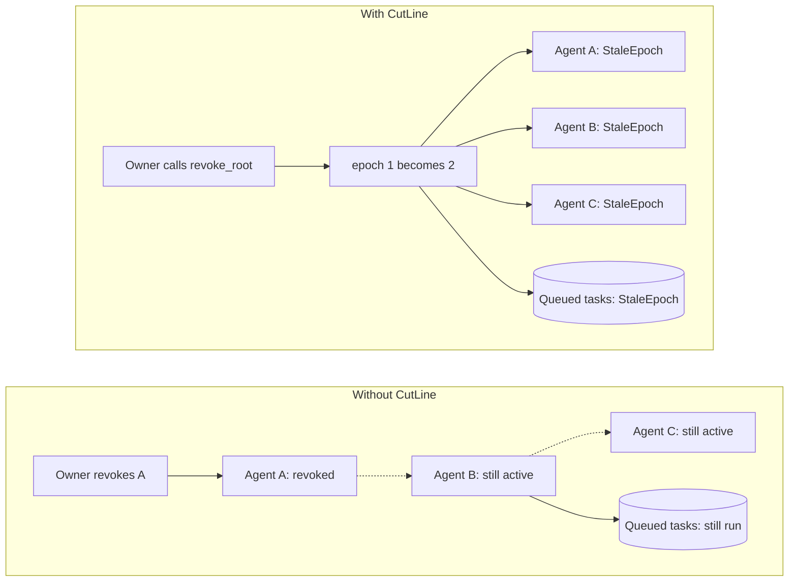
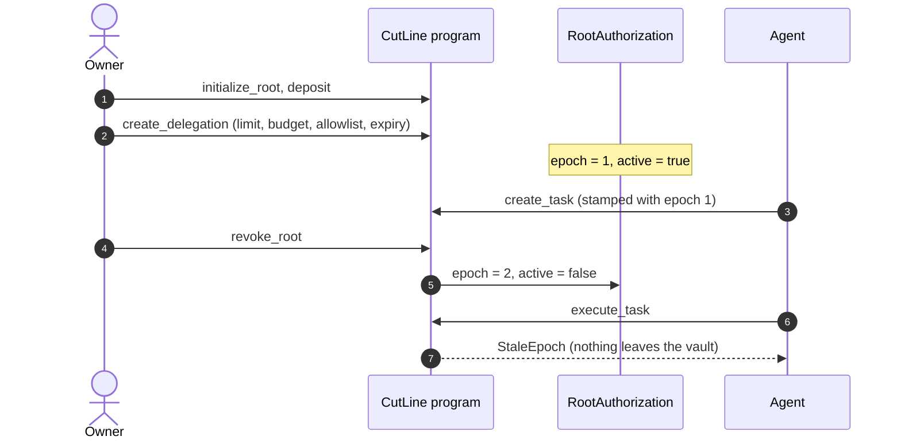
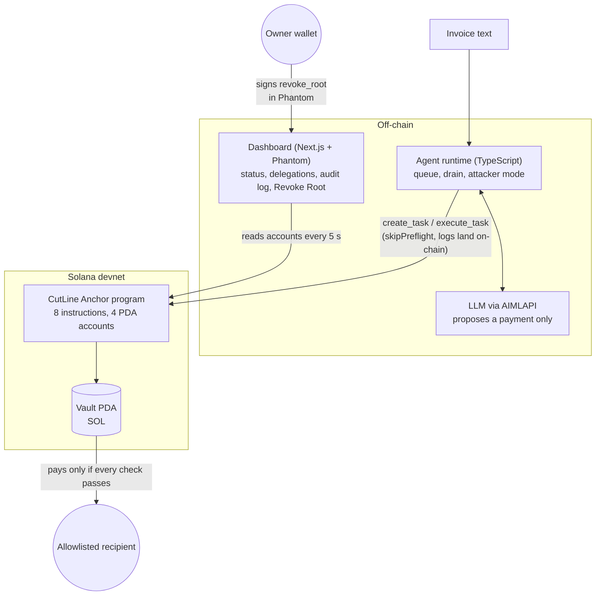
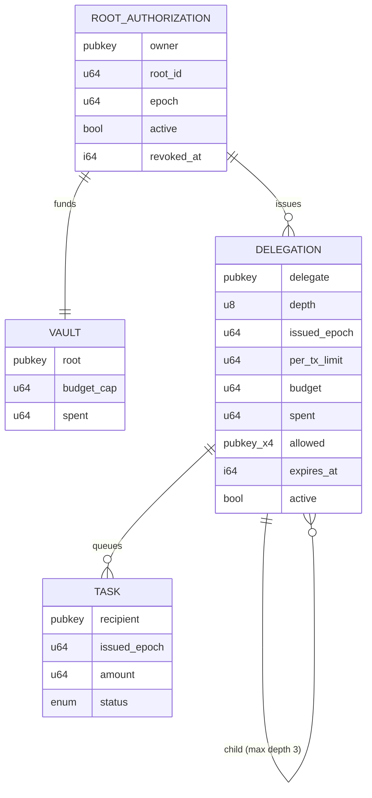
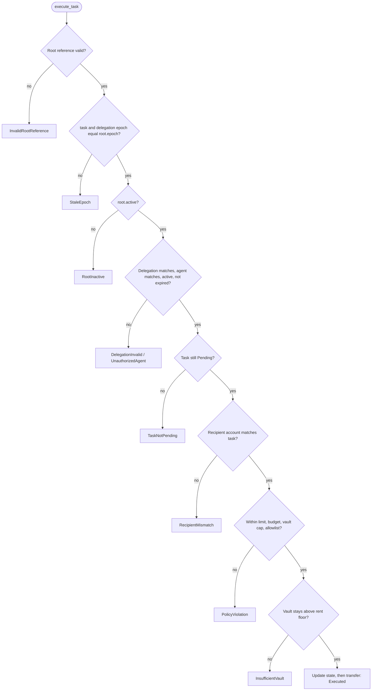

# CutLine

**Revocable spend authority for AI agents on Solana.**
Give the agent a policy, not your money. One `revoke_root` transaction invalidates the whole delegation tree and every queued task.

[](https://explorer.solana.com/address/FDuzi1FjZ5hPK6VxbrKvm6oJ7rWLxMWqvrRMtnsxbiwu?cluster=devnet)
[](https://www.anchor-lang.com/)
[](#run-the-tests)
[](#license)

| | |
|---|---|
| **Live dashboard** | https://cut-line-blond.vercel.app/ (reads devnet accounts directly) |
| **Program (devnet)** | [`FDuzi1FjZ5hPK6VxbrKvm6oJ7rWLxMWqvrRMtnsxbiwu`](https://explorer.solana.com/address/FDuzi1FjZ5hPK6VxbrKvm6oJ7rWLxMWqvrRMtnsxbiwu?cluster=devnet) |
| **Devnet proof** | [`docs/devnet-proof.md`](docs/devnet-proof.md), real signatures you can open in Explorer |
| **Threat model** | [`docs/threat-model.md`](docs/threat-model.md) |

## Contents

1. [The problem](#the-problem)
2. [The idea: epoch revocation](#the-idea-epoch-revocation)
3. [Architecture](#architecture)
4. [On-chain accounts](#on-chain-accounts)
5. [What `execute_task` checks](#what-execute_task-checks)
6. [Demo flow](#demo-flow)
7. [Repository layout](#repository-layout)
8. [Run the tests](#run-the-tests)
9. [Run the demo on devnet](#run-the-demo-on-devnet)
10. [Dashboard](#dashboard)
11. [Security and limitations](#security-and-limitations)
12. [Built with](#built-with)

## The problem

Authority in an agent economy is delegated down a chain: owner → agent A → agent B → agent C. When the owner revokes A,
B and C still hold their old authority, and tasks already sitting in their queues can still run. A Solana program cannot
scan for descendants, so revoking N agents takes N transactions, and a compromised agent can keep spending in the meantime.



## The idea: epoch revocation

1. **Epoch revocation, O(1).** Each root authorization has an `epoch`. Every delegation and every task stores the epoch it
   was issued under. `execute_task` requires `task.issued_epoch == root.epoch`, `delegation.issued_epoch == root.epoch`
   and `root.active`. `revoke_root` bumps the epoch and sets `active = false`: one write, and the whole tree is stale.
2. **Vault and policy bound the damage.** SOL sits in a vault PDA. An agent cannot touch it; it can only ask the program
   to pay, and the program checks per-transaction limit, delegation budget, vault-wide budget cap, a recipient allowlist
   (max 4) and expiry. Child policies must fit inside the parent.
3. **LLM output is never an authorization.** The model only proposes. The Anchor program decides.



## Architecture



The chain is the source of truth. The agent and the dashboard only ask and display; enforcement is always on-chain, and no
backend is involved in signing.

## On-chain accounts



| Account | PDA seeds |
|---|---|
| `RootAuthorization` | `["root", owner, root_id]` |
| `Vault` | `["vault", root]` |
| `Delegation` | `["deleg", root, delegate]` |
| `Task` | `["task", delegation, task_id]` |

Instructions: `initialize_root`, `deposit`, `create_delegation`, `revoke_delegation`, `create_task`, `execute_task`,
`revoke_root`, `withdraw`.

## What `execute_task` checks

The checks run in a fixed order so errors are deterministic. State is updated before lamports move (checks, effects,
then interaction).



## Demo flow

| Step | Command | Result on devnet |
|---|---|---|
| 1 | `agent run invoices/normal.txt` | `Executed` |
| 2 | `ATTACKER_MODE=1 agent run invoices/malicious.txt` | `PolicyViolation` |
| 3 | `agent queue invoices/normal.txt` | task waits in the queue |
| 4 | `revoke` | `revoke_root`, epoch 1 → 2 |
| 5 | `agent drain` | `StaleEpoch` |

Signatures for each step are in [`docs/devnet-proof.md`](docs/devnet-proof.md).

## Repository layout

```
programs/cutline/   Anchor program: 4 PDA accounts, 8 instructions
tests/              16 Anchor tests (T1-T14 plus withdraw and a race test)
agent/              TypeScript runtime: LLM tool call, revocation-aware queue, attacker mode
frontend/           Next.js dashboard with Phantom: status, vault, delegations, tasks, audit log, Revoke Root
docs/               threat model, devnet proof
```

## Run the tests

Anchor CLI 0.31.1 (`anchor-lang` 0.31.3), Solana CLI / Agave 4.3.2 (platform-tools v1.57, rustc 1.95.0 for SBF),
host Rust 1.99.1, Node 24.10.0, Yarn 1.22.22. Built on Ubuntu 24.04 (WSL2). `Cargo.lock` pins `blake3 1.8.2`.

```bash
yarn install
anchor test        # starts a local validator and runs all 16 tests
```

## Run the demo on devnet

```bash
solana config set --url devnet
anchor build && anchor deploy --provider.cluster devnet

cd agent
npm install
cp .env.example .env               # fill AIMLAPI_API_KEY
npm run setup                      # creates a root, funds the vault, delegates to the agent; prints env values
npm run agent -- run invoices/normal.txt      # paid, Executed
ATTACKER_MODE=1 npm run agent -- run invoices/malicious.txt   # rejected: PolicyViolation
npm run agent -- queue invoices/normal.txt    # a task waits in the queue
npm run revoke -- --withdraw                  # owner revokes the root (epoch 1 -> 2)
npm run agent -- drain                        # queued task now fails: StaleEpoch
```

The agent sends with `skipPreflight`, so rejected transactions land on-chain with logs and a signature you can open in Explorer.
Never commit `.env` or keypair files; both are in `.gitignore`.

## Dashboard

Live: https://cut-line-blond.vercel.app/

```bash
cd frontend
npm install
cp .env.example .env.local   # set NEXT_PUBLIC_ROOT_OWNER and NEXT_PUBLIC_ROOT_ID
npm run dev
```

It reads accounts straight from devnet (the chain is the source of truth). The Revoke Root button opens a confirmation
modal and the owner signs in Phantom; no backend is involved in signing. Rejected attempts in the audit log show the
program's own error code.

## Security and limitations

Assumption: the agent key, the agent process and its LLM can be fully controlled by an attacker. The owner's wallet key is
safe. Full table of attacks and defenses: [`docs/threat-model.md`](docs/threat-model.md).

| Attack | Defense | Result |
|---|---|---|
| Prompt injection: pay an attacker address | on-chain allowlist and per-tx limit | `PolicyViolation` |
| Run an old task after revoke | `task.issued_epoch != root.epoch` | `StaleEpoch` |
| Replay the same task | status must be `Pending` | `TaskNotPending` |
| Revoke from another wallet | `root.owner == signer` | `UnauthorizedOwner` |

Honest limits: transactions that landed before the revoke are not undone (loss is bounded by the budget), off-chain side
effects cannot be reversed, owner key compromise is out of scope, SOL only, devnet only, not audited.

## Built with

Solana, Anchor, Rust, TypeScript, Next.js, Tailwind CSS, Solana Wallet Adapter (Phantom), Vercel. The agent calls an
OpenAI-compatible API (AIMLAPI). This project was built with AI assistance (Claude) for code, documentation and design;
the on-chain behavior is covered by the tests and the devnet proof above.

## License

MIT
